<div align="center">




<br/>

[](https://github.com/oneusebiomaria-crypto)
[](https://github.com/oneusebiomaria-crypto)


</div>


# 👋 ¡Hola! Soy Eusebio María

💻 Estudiante de Desarrollo de Aplicaciones Multiplataforma (DAM) | 🌐 Desarrollo web | ⚽ Fútbol

¡Bienvenido a mi perfil de GitHub!

Soy **Eusebio María Esono** y actualmente estoy aprendiendo programación y desarrollo de aplicaciones. Me gusta descubrir cómo funcionan las cosas, probar nuevas ideas y convertir poco a poco lo que aprendo en proyectos propios.

Estoy dando mis primeros pasos en el mundo del desarrollo y cada ejercicio me ayuda a entender un poco más cómo funciona la tecnología.

No se trata solo de escribir código, sino también de equivocarse, buscar soluciones y seguir mejorando.

### 🛰️ ID DE DESARROLLADOR

```text
┌──[ eusebio@dam:~ ]──────────────────────────────
│
│  NOMBRE ....... Eusebio María Esono
│  ROL .......... Estudiante DAM · Web Developer
│  STACK ........ HTML · CSS · JS · Python · SQL
│  SISTEMA ...... Linux · Ubuntu · Git · GitHub
│  PASIÓN ....... Fútbol ⚽ · Nzalang Nacional 🇬🇶
│  ESTADO ....... ● ONLINE · aprendiendo cada día
│
└──────────────────────────────────────────────────
```


## ⚡ 01 // LO QUE ESTOY APRENDIENDO

Me gusta aprender practicando. Estas son algunas de las tecnologías con las que estoy trabajando:

<div align="center">


</div>

| Tecnología | En qué estoy trabajando |
|---|---|
| 🌐 HTML y CSS | Creando páginas web y mejorando su diseño. |
| 🐍 Python | Variables, condiciones, bucles y clases. |
| 🗄️ SQL y MySQL | Bases de datos, tablas, relaciones y consultas. |
| 🐧 Linux y Ubuntu | Descubriendo Linux y sus herramientas. |
| ⚙️ JavaScript | Dando interactividad a las páginas web. |
| 🛠️ Git y GitHub | Guardando, organizando y compartiendo proyectos. |

### 🔋 BARRAS DE XP

> Ajusta los bloques a tu nivel real: cada `▰` es un punto de progreso.

```text
HTML / CSS    ▰▰▰▰▰▰▰▱▱▱
Python        ▰▰▰▰▰▱▱▱▱▱
SQL / MySQL   ▰▰▰▰▱▱▱▱▱▱
JavaScript    ▰▰▰▱▱▱▱▱▱▱
Linux         ▰▰▰▱▱▱▱▱▱▱
Git / GitHub  ▰▰▰▰▱▱▱▱▱▱
```

Todavía me queda mucho por aprender, pero precisamente eso es lo que hace interesante este camino.


## 🌐 02 // MIS PROYECTOS

Me gusta la idea de crear cosas que tengan utilidad y que, además, me permitan aprender algo nuevo.

Algunos de los proyectos que me interesa desarrollar están relacionados con:

**🎮 Desarrollo web**
- Diseños modernos y páginas personales.
- Tiendas online y pequeños sitios web.

**⚽ Fútbol**
- Webs con noticias, jugadores y resultados.
- Información de equipos y competiciones.

**🇬🇶 Nzalang Nacional**
- Una página dedicada a la selección de Guinea Ecuatorial.
- Información sobre jugadores y novedades.
- Un espacio para representar al equipo y a sus aficionados.

**🗄️ Bases de datos**
- Organización de información de jugadores y equipos.
- Tablas, relaciones y consultas SQL.

**🎨 Diseño web**
- Colores, fondos, imágenes y animaciones.
- Experimentación con diferentes estilos CSS.

**💡 Pequeños programas**
- Ejercicios de programación.
- Prácticas para mejorar mis conocimientos.

Mi objetivo es ir transformando las ideas que tengo en proyectos cada vez más completos.

### 🎯 REGISTRO DE MISIONES

- [ ] 🇬🇶 Web del **Nzalang Nacional**
- [ ] ⚽ Web de fútbol con noticias, jugadores y resultados
- [ ] 🛒 Tienda online
- [ ] 🗄️ Base de datos de jugadores y equipos
- [ ] 🌐 Mi página personal con diseño moderno


## ⭐ 03 // PROYECTOS DESTACADOS

<div align="center">

<a href="https://github.com/oneusebiomaria-crypto/REPOSITORIO_1">

</a>

<a href="https://github.com/oneusebiomaria-crypto/REPOSITORIO_2">

</a>

</div>


## ⚽ 04 // UNA DE MIS INSPIRACIONES: EL FÚTBOL

El fútbol es uno de los temas que me gusta llevar al mundo de la tecnología.

Me interesa la idea de combinar ambas cosas creando páginas web donde se pueda consultar información sobre equipos, jugadores, noticias y resultados.

También me gustaría seguir desarrollando ideas relacionadas con el **Nzalang Nacional**, la selección de Guinea Ecuatorial, y crear un espacio web que represente al equipo y a sus aficionados.

Porque programar no tiene por qué ser solamente hacer ejercicios: también puede servir para construir cosas relacionadas con lo que nos gusta.


## 📊 05 // GITHUB STATISTICS

<div align="center">


<br/>


<br/>


</div>

### 🏆 TROFEOS

<div align="center">


</div>


## 🐍 06 // CONTRIBUTION SNAKE

<div align="center">


</div>


## 📚 07 // MI CAMINO EN LA PROGRAMACIÓN

Ahora mismo estoy en una etapa en la que cada día intento aprender algo nuevo.

A veces una página no queda como esperaba, un programa da errores o una consulta SQL no funciona a la primera. Pero parte del aprendizaje consiste precisamente en entender qué ha pasado y encontrar la solución.

Mi forma de avanzar es sencilla:

1. Aprender un concepto.
2. Probarlo con un ejemplo.
3. Cometer errores y corregirlos.
4. Aplicarlo a un proyecto.
5. Seguir aprendiendo.

No pretendo saberlo todo desde el principio. Prefiero aprender bien las bases y construir sobre ellas.

<details>
<summary>🖥️ <b>Abrir terminal: registro de arranque</b></summary>

```bash
$ ./iniciar_perfil.sh
[ OK ] Cargando pasión por el código ............ listo
[ OK ] Montando proyectos de fútbol ............. listo
[ OK ] Conectando con Nzalang Nacional 🇬🇶 ....... listo
[ OK ] Compilando conocimientos de DAM .......... en progreso
[ >> ] Siguiente objetivo: seguir aprendiendo
```

</details>


## 🎯 08 // MI OBJETIVO

Quiero seguir mejorando como desarrollador, ganar experiencia y ser capaz de crear mis propias aplicaciones y páginas web.

Me gustaría que este perfil fuera una pequeña colección de mi progreso: los ejercicios que voy haciendo, las ideas que voy desarrollando y los proyectos que consiga terminar.

Si dentro de un tiempo vuelvo a mirar mis primeros códigos, espero poder ver cuánto he avanzado.


## 🤝 09 // GRACIAS POR VISITAR MI PERFIL

Si has llegado hasta aquí, ¡gracias por dedicar un momento a conocerme!

Este perfil está en construcción, igual que mis conocimientos de programación. Poco a poco iré añadiendo nuevos proyectos y compartiendo lo que vaya aprendiendo.

**Seguimos aprendiendo, seguimos programando.** 🚀

---

<div align="center">

### 💜 MY DEVELOPER PHILOSOPHY

```python
class Developer:
    nombre = "Eusebio María Esono"
    rol = "Estudiante de DAM"
    pasiones = ["Programar", "Fútbol", "Nzalang Nacional"]

    def vivir(self):
        while self.tengo_ganas_de_aprender:
            self.practicar()
            self.equivocarse()
            self.corregir()
            self.mejorar()
```

<br/>

**Eusebio María Esono**

Estudiante de DAM · Futuro desarrollador · Siempre aprendiendo.

<br/>


<sub>BUILD · LEARN · CREATE | © 2026</sub>

</div>
